# Resultados comparativos de InverSeek

Medias de los benchmarks originales. Menor tiempo y menor espacio son mejores.

Datalake: 5 repeticiones. Índice invertido: 3 repeticiones.

**Limitaciones:** existen diferencias de tamaños almacenados, vocabulario y algunos IDs entre lenguajes; las comparaciones son descriptivas y no prueban igualdad completa de cargas de trabajo. Los valores de escalabilidad se presentan por separado de las pruebas principales de 100 libros.

## Datalake

### Escritura de 100 libros

| Estructura | Python (s) | Java (s) | C (s) |
|---|---:|---:|---:|
| `time_based` | 0.198737 | 0.187218 | 0.105407 |
| `book_based` | 0.191481 | 0.162617 | 0.113575 |
| `range_based` | 0.276483 | 0.161645 | 0.177346 |

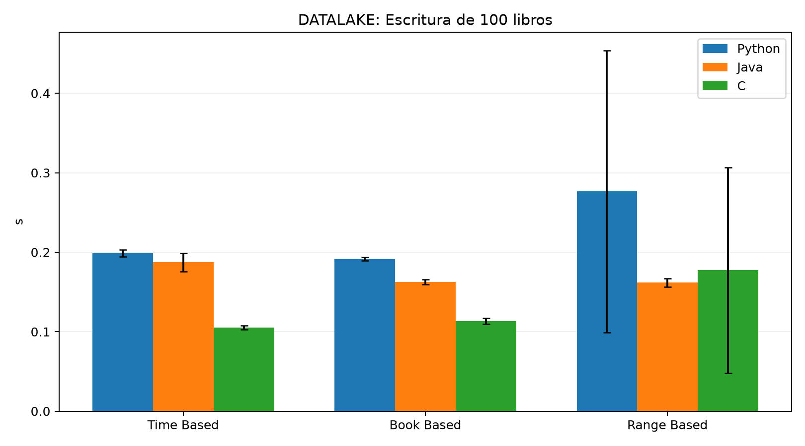

### Búsqueda de libros

| Estructura | Python (ms) | Java (ms) | C (ms) |
|---|---:|---:|---:|
| `time_based` | 0.175148 | 1.600823 | 0.142145 |
| `book_based` | 0.038027 | 0.013587 | 0.012856 |
| `range_based` | 0.039170 | 0.013383 | 0.012551 |

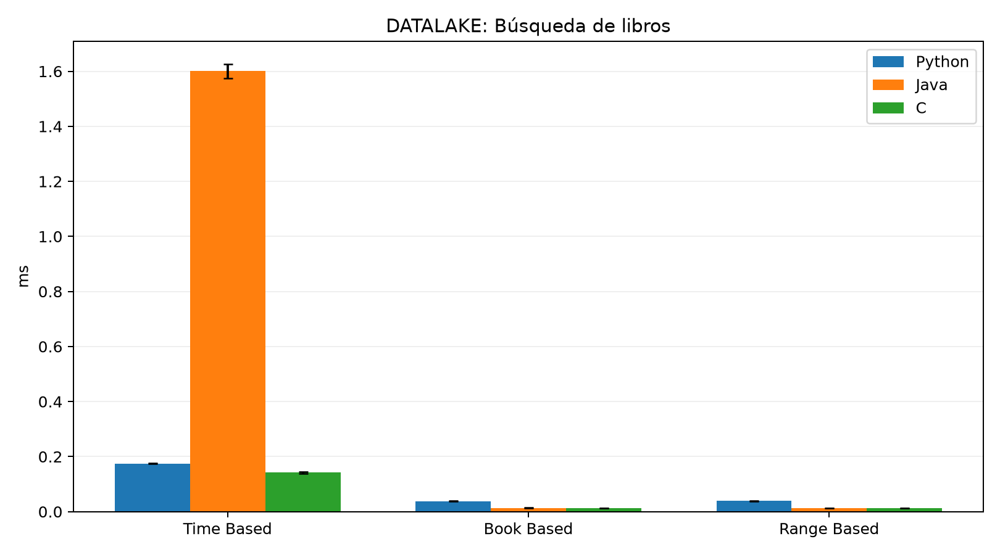

### Inserción incremental de 10 libros

| Estructura | Python (s) | Java (s) | C (s) |
|---|---:|---:|---:|
| `time_based` | 0.014112 | 0.023380 | 0.012288 |
| `book_based` | 0.013849 | 0.022571 | 0.014592 |
| `range_based` | 0.014767 | 0.022661 | 0.012284 |

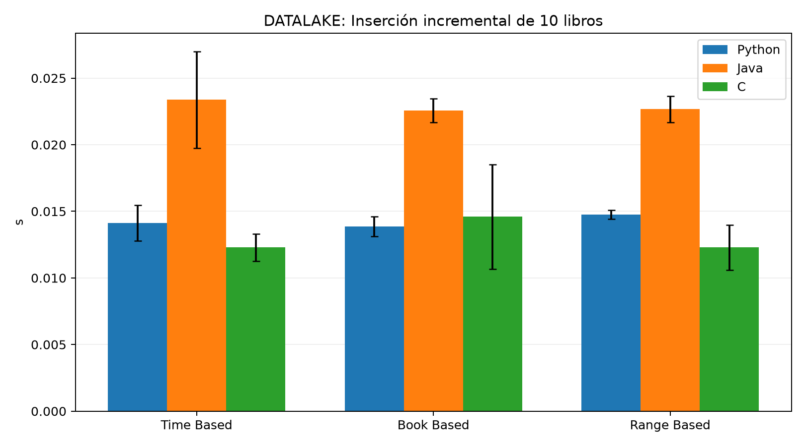

### Detección de libros pendientes

| Estructura | Python (s) | Java (s) | C (s) |
|---|---:|---:|---:|
| `time_based` | 0.004678 | 0.004080 | 0.000267 |
| `book_based` | 0.014432 | 0.009875 | 0.003900 |
| `range_based` | 0.004542 | 0.003815 | 0.000389 |

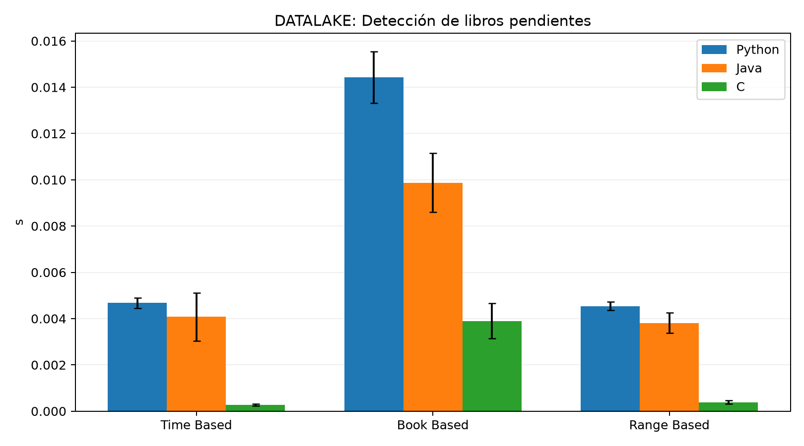

### Almacenamiento

| Estructura | Python (MB) | Java (MB) | C (MB) |
|---|---:|---:|---:|
| `time_based` | 58.560000 | 57.240000 | 57.240000 |
| `book_based` | 58.560000 | 57.240000 | 57.240000 |
| `range_based` | 58.560000 | 57.240000 | 57.240000 |

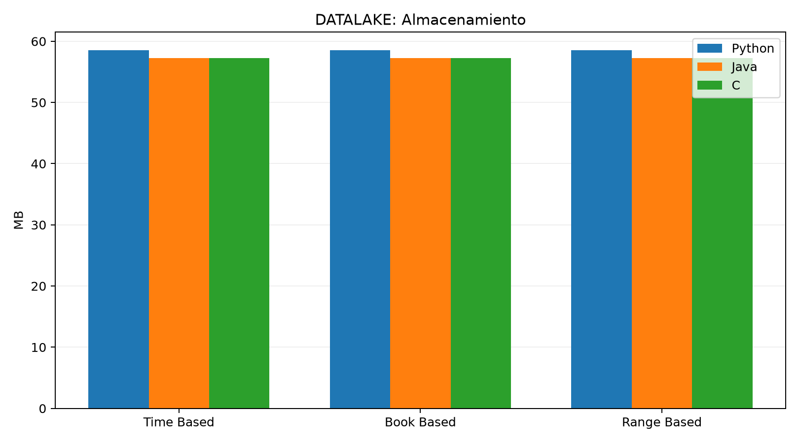

## Index

### Construcción del índice

| Estructura | Python (s) | Java (s) | C (s) |
|---|---:|---:|---:|
| `monolithic` | 4.449514 | 1.416649 | 3.170840 |
| `term_files` | 62.729803 | 25.773413 | 71.786624 |
| `hierarchical` | 70.947523 | 30.721023 | 75.301243 |

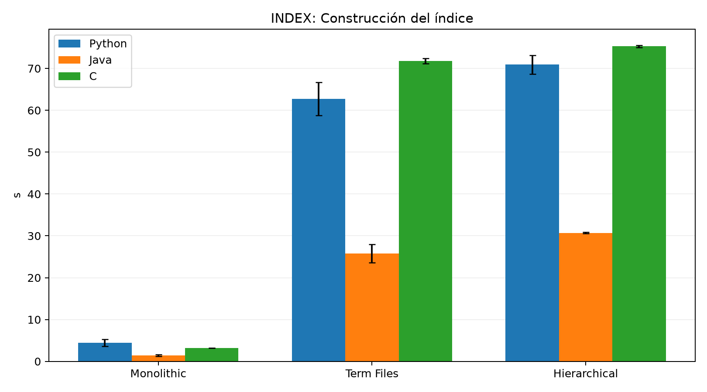

### Consulta del índice

| Estructura | Python (ms) | Java (ms) | C (ms) |
|---|---:|---:|---:|
| `monolithic` | 85.085707 | 96.005345 | 103.343015 |
| `term_files` | 0.124572 | 0.063292 | 0.048613 |
| `hierarchical` | 0.121877 | 0.064876 | 0.048258 |

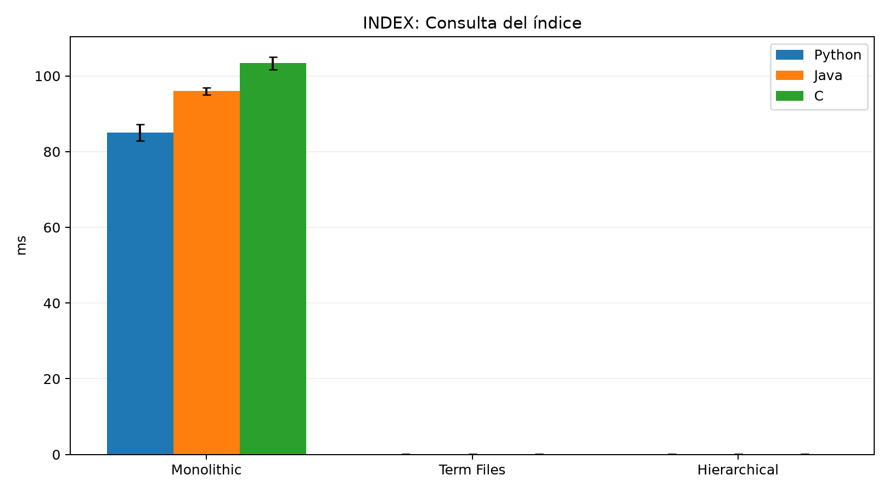

### Actualización incremental

| Estructura | Python (s) | Java (s) | C (s) |
|---|---:|---:|---:|
| `monolithic` | 0.863821 | 0.294142 | 104.498687 |
| `term_files` | 8.329237 | 6.234494 | 27.451577 |
| `hierarchical` | 9.885269 | 7.425493 | 26.957316 |

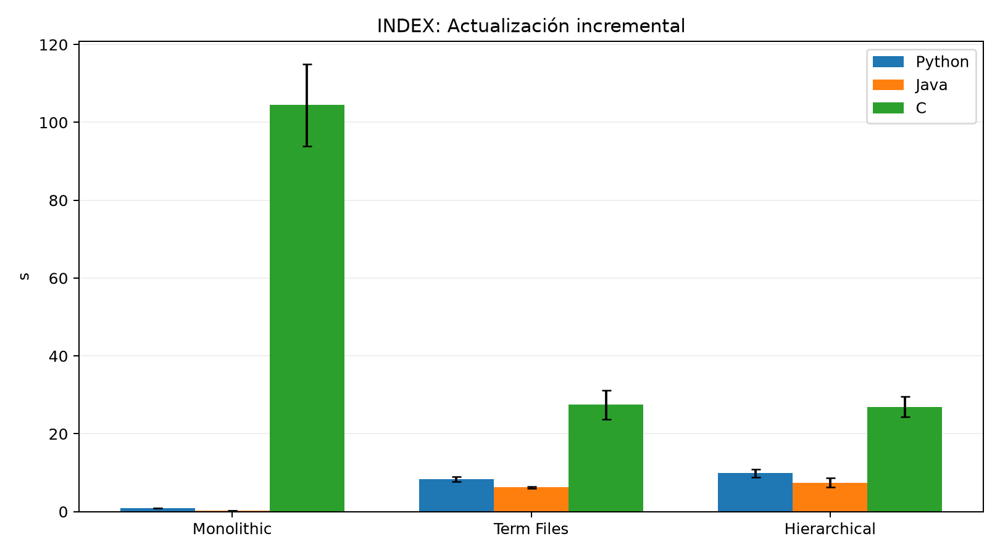

### Reconstrucción completa

| Estructura | Python (s) | Java (s) | C (s) |
|---|---:|---:|---:|
| `monolithic` | 3.421683 | 1.423144 | 3.583866 |
| `term_files` | 54.209286 | 26.934077 | 83.063904 |
| `hierarchical` | 64.022802 | 34.591408 | 88.249094 |

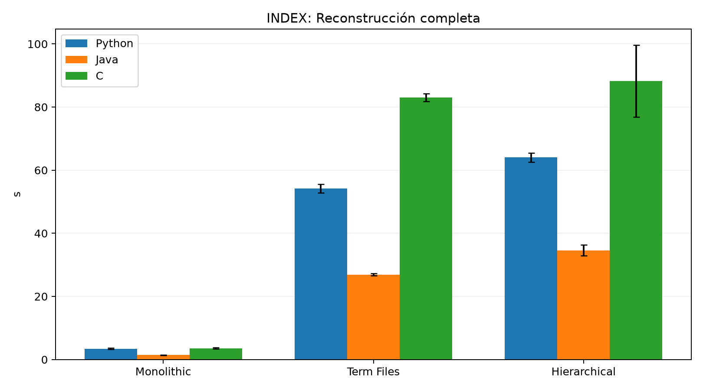

### Almacenamiento

| Estructura | Python (MB) | Java (MB) | C (MB) |
|---|---:|---:|---:|
| `monolithic` | 5.020000 | 4.330000 | 4.330000 |
| `term_files` | 3.630000 | 3.140000 | 3.140000 |
| `hierarchical` | 3.630000 | 3.140000 | 3.140000 |

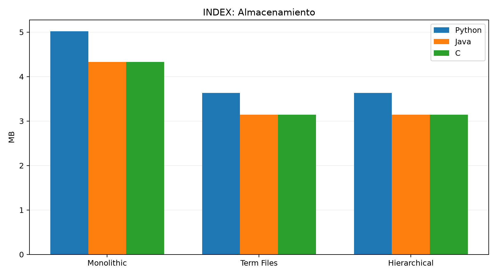

## Escalabilidad del datalake

Resultados específicos de las pruebas con 10, 25, 50 y 100 libros.

### Write (s)

| Libros | Estructura | Python | Java | C |
|---:|---|---:|---:|---:|
| 10 | `time_based` | 0.042238 | 0.053298 | 0.009959 |
| 10 | `book_based` | 0.083778 | 0.019815 | 0.010409 |
| 10 | `range_based` | 0.070294 | 0.043971 | 0.010037 |
| 25 | `time_based` | 0.143712 | 0.082444 | 0.027619 |
| 25 | `book_based` | 0.094877 | 0.039110 | 0.089867 |
| 25 | `range_based` | 0.099480 | 0.046188 | 0.026962 |
| 50 | `time_based` | 0.157592 | 0.098216 | 0.062463 |
| 50 | `book_based` | 0.199230 | 0.078318 | 0.062740 |
| 50 | `range_based` | 0.181495 | 0.080352 | 0.061937 |
| 100 | `time_based` | 0.286800 | 0.331600 | 0.121832 |
| 100 | `book_based` | 0.260982 | 0.149934 | 0.120040 |
| 100 | `range_based` | 0.236340 | 0.157984 | 0.121177 |

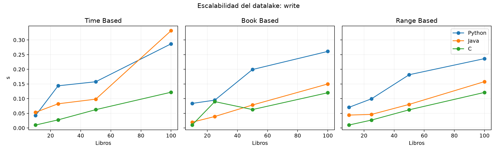

### Lookup (ms)

| Libros | Estructura | Python | Java | C |
|---:|---|---:|---:|---:|
| 10 | `time_based` | 0.226039 | 0.304771 | 0.090911 |
| 10 | `book_based` | 0.056387 | 0.013475 | 0.012956 |
| 10 | `range_based` | 0.078228 | 0.013354 | 0.013486 |
| 25 | `time_based` | 0.253245 | 0.526481 | 0.122998 |
| 25 | `book_based` | 0.050315 | 0.013444 | 0.012878 |
| 25 | `range_based` | 0.053449 | 0.013426 | 0.013097 |
| 50 | `time_based` | 0.222625 | 0.905187 | 0.146642 |
| 50 | `book_based` | 0.067644 | 0.013169 | 0.013021 |
| 50 | `range_based` | 0.055369 | 0.013163 | 0.012970 |
| 100 | `time_based` | 0.269787 | 1.583500 | 0.140469 |
| 100 | `book_based` | 0.047402 | 0.013108 | 0.013159 |
| 100 | `range_based` | 0.046481 | 0.013282 | 0.013039 |

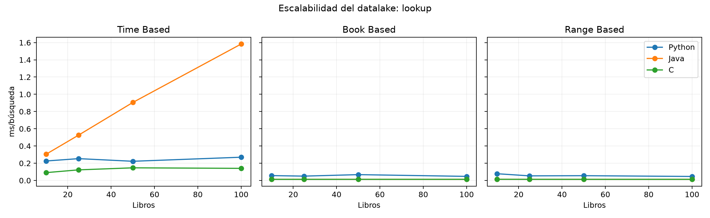

